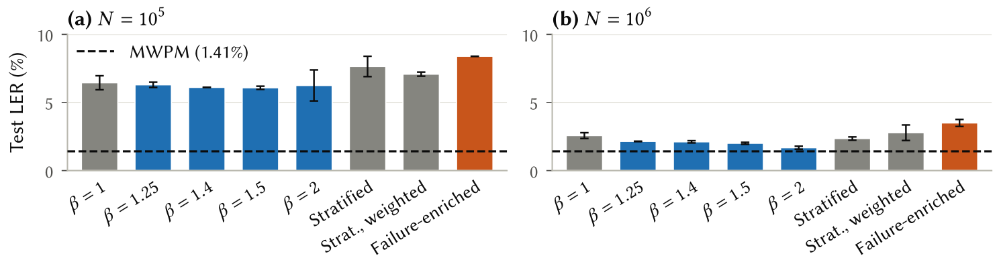

# How Training Data Affect a 3D-CNN Surface-Code Decoder

Code and results for

> **How Training Data Affect a 3D-CNN Surface-Code Decoder**\
> Hyungsuk Lee, In-Nea Wang, Kang Woo Lee, Yunsik Son, Jin-Woo Jung, Junho Jeong (Dongguk University)\
> Submitted to ICCDE 2027. The paper will be linked here after review.

A neural decoder for quantum error correction learns from simulated shots, so which shots to generate, how many, and which training target each one carries are design choices. We compare them for one 3D convolutional neural network (3D-CNN) decoder on rotated surface-code memory experiments at distances 3, 5, and 7 under circuit-level noise, with minimum-weight perfect matching (MWPM) as the reference. The work has four studies and three follow-up checks whose pass criteria were fixed before they ran.

At distance 5, the clearest effects came from two choices that need nothing beyond the simulator. Sampling above the target error rate matched target-rate training at 10<sup>6</sup> shots with 1.2 to 2.6 times fewer shots, depending on the schedule and error rate, while keeping every shot that MWPM fails on raised the logical error rate (LER) by 36% (two seeds). On one training set, label smoothing with ε = 0.1 showed no detected difference from soft targets of a near-optimal decoder, Tesseract. The data needed to reach MWPM grew steeply with distance: about 10<sup>5</sup> shots at distance 3, 2 to 3 × 10<sup>6</sup> at distance 5, and more than 4 × 10<sup>6</sup> at distance 7.

| Training target, d = 5 | Runs | Median R | Range |
|---|---|---|---|
| Hard (sampled flip)                       | 9  | 1.28 | 1.16–1.84 |
| Soft, from MWPM                           | 9  | 1.19 | 1.16–1.41 |
| Soft, from Tesseract                      | 17 | 1.00 | 0.85–1.33 |
| Label smoothing, ε = 0.1                  | 16 | 0.99 | 0.86–1.45 |
| Hard, twice the data (2 × 10<sup>6</sup>) | 9  | 1.01 | 0.86–1.16 |

R is the LER divided by the LER of MWPM, so lower is better and 1 is parity. Target error rate 0.3%, training shots sampled at three times that rate, 10<sup>6</sup> shots unless noted. Paired over 16 seeds, label smoothing gave 1.00 [0.96, 1.05] times the LER of Tesseract targets. This is part of Table 2 of the paper (`analysis/tables.py` writes all of it).

<p align="center"></p>

Figure 1 of the paper: test LER at distance 5 and a target error rate of 0.5% for each sampling method, with 10<sup>5</sup> (a) and 10<sup>6</sup> (b) training shots. Bars are means of two seeds and error bars span both. β is the training error rate divided by the target error rate.

## Repository layout

```
experiments/sampling/          sampling study: target-rate, higher-rate, stratified, and failure-enriched shots at d = 5
experiments/scaling/           scaling study: training set size and training error rate at d = 3, 5, and 7
experiments/posterior/         posterior study: exact (d = 3) and matching-based soft targets
experiments/teacher/           teacher study: Tesseract soft targets, temperature, and label smoothing at d = 5 and 7
experiments/checks/            the three follow-up checks: beta = 1 smoothing (part a), exact posterior (b), step count (c)
experiments/exact_posterior.py exact posterior of a logical flip at d = 3
analysis/                      every number, table, and figure of the paper, from data/
data/s1, p1, ex12, ex17, supp  results and logs of the sampling, scaling, posterior, and teacher studies and the checks
data/MD5SUMS                   checksums of the result files
figures/                       Figure 1 of the paper, for this README
```

## Reproducing the paper's numbers, tables, and figures

The released results are enough; no training is needed.

```
pip install -r requirements.txt
python analysis/numbers.py   # every number, data/numbers.json
python analysis/tables.py    # LaTeX rows of Table 2 (labels.tex), in out/tables/
python analysis/figs.py      # Figures 1 to 4 as PDF, in out/figs/
```

`analysis/claims.py` ties 140 numbers in the text of the paper to the values they were computed from, and `numbers.py` stops if a printed value does not round from the data. It prints `140 claims checked, 0 failed` and rewrites `data/numbers.json` unchanged. `tables.py` reproduces the paper's table files byte for byte, and `figs.py` the figure PDFs apart from their creation date. `figs.py` sets figure text with pdflatex and needs the `libertine` and `newtx` LaTeX packages. Checked with Python 3.14.4, numpy 2.2.6, scipy 1.18.1, matplotlib 3.11.2, and stim 1.16.0.

## Rerunning the experiments

Training needs a CUDA GPU. The sampling, scaling, and posterior studies ran on a local GPU. The teacher study and the checks ran on a server with four NVIDIA H200 GPUs, one process per GPU. There, a d = 5 run on 10<sup>6</sup> shots took about 1.5 minutes and a d = 7 run on 4 × 10<sup>6</sup> shots about 11 minutes. Tesseract targets for 10<sup>6</sup> shots took about 50 minutes at d = 5 (beam 20) and 3.5 hours at d = 7 (beam 10) on 240 to 256 threads. Training shots come from fixed sampler seeds, so a rerun draws the same shots. Runs repeated on the same server gave identical results.

```
# Sampling, scaling, and posterior studies: each line from the repository root (results go to results/ in that folder)
cd experiments/sampling && mkdir -p results && python sanity.py 5 0.005 && python compare.py 0.005 2
cd experiments/scaling && mkdir -p results && python p1_scaling.py
cd experiments/posterior && mkdir -p results && python b3_relabel.py && python b4_teachers.py && python b4_train.py

# Teacher study: from experiments/ (results go to teacher/results/)
python teacher/t1_teacher.py 50000
python teacher/t2_train.py 2000000                  # also writes the d = 5 targets, t2_labels_<stamp>.npz
python teacher/t3_seeds.py <t2 labels> 1,2          # and 3,4  5,6  7,8
python teacher/t4_compute.py <t2 labels> 1,2        # and 3,4  5,6  7,8
python teacher/t9_d5_controls.py <t2 labels> 1,2    # and 3,4  5,6  7,8
LS_EPS=0.1 WITH_TESS1=1 python teacher/t9_d5_controls.py <t2 labels> 9,10   # and 11,12  13,14  15,16
python teacher/t6_labels7.py 4000000 1000000 10     # d = 7 targets, Tesseract beam 10
python teacher/t7_train7.py <t6 labels> <seeds> <method@N,...>   # one job per log in data/ex17/logs/t7*.log
python teacher/t8_labeldiag.py <t2 labels> <t6 labels>

# Checks: from the repository root, one process per GPU
python experiments/checks/u_smoke.py
python experiments/checks/u_runs.py a:1,2 c:1 b:1,2   # and a:3,4 c:2 b:3,4 / a:5,6 c:3 b:5,6 / a:7,8 c:4 b:7,8
```

The first line of each log in `data/ex17/logs/` and `data/supp/logs/` gives the exact command and seeds of that run. The logs do not record environment variables. The settings of `t9_d5_controls.py` for seeds 9 to 16 are inferred from their result files, which contain only ε = 0.1 smoothing, temperature-2 Tesseract targets, and plain Tesseract targets.

## Protocol in brief

- **Circuits and noise.** Rotated surface-code memory experiments in the Z basis with d rounds, generated by Stim. Depolarizing noise of strength p follows each Clifford gate and hits data qubits before each round. Bit flips with probability p follow each reset and precede each measurement. Target error rates are 0.5% (sampling and scaling studies) and 0.3% (posterior and teacher studies), and training shots are sampled at β times the target rate.
- **Model.** Detection events on a (t, x, y) grid of shape (d + 1)<sup>3</sup>. Four 3 × 3 × 3 convolutional layers with 64 channels and GELU are followed by a dense layer of 256 units and one output logit. The model has 1.38, 3.87, and 8.72 million parameters at d = 3, 5, and 7.
- **Training.** Binary cross-entropy, AdamW with learning rate 10<sup>−3</sup> and weight decay 10<sup>−4</sup>, a one-cycle schedule, and batch size 2048. The sampling study trains for 20, 12, and 8 epochs at 10<sup>5</sup>, 3 × 10<sup>5</sup>, and 10<sup>6</sup> shots and keeps the final state. The other experiments train for max(10 epochs, 6000 steps) and keep the checkpoint with the best LER on 10<sup>5</sup> validation shots at the target rate (2 × 10<sup>5</sup> at d = 7 in the teacher study).
- **Targets.** Hard targets are the logical flips sampled with the shots. MWPM and Tesseract soft targets are σ(W<sub>0</sub> − W<sub>1</sub>), where W<sub>k</sub> is the decoder's minimum weight with the logical observable added as a detector fixed to k, under target-rate weights. Exact posteriors at d = 3 come from the full joint distribution of syndromes and flips. Label smoothing replaces a hard target y with (1 − ε)y + ε/2.
- **Evaluation.** LER on 10<sup>6</sup> test shots at the target rate, reported as R = LER / LER<sub>MWPM</sub>. Paired comparisons report the geometric mean of per-seed ratios with a 95% bootstrap interval from 20,000 resamples.

## Notes

- **Changes from the code as run.** Import paths, which pointed to folders on the machines the code ran on, now point inside this repository. Four scripts loaded the exact-posterior functions with `exec` from a larger pilot script; `experiments/exact_posterior.py` holds those functions unchanged. Internal folder names in comments were replaced by the study names, and `analysis/` writes to `out/`. In seven logs, the server's directory path in a Python traceback is replaced by `<server>/`. Nothing else in the code or the result files was changed.
- **Superseded run.** `data/p1/results/p1_20261008_144244_FLAWED_fixed_epochs.json` and `p1_log_FLAWED.txt` come from an earlier scaling run with a fixed number of epochs. It was replaced by `p1_20261008_144832.json`, which sets a floor on the step count. The paper uses only the second run.
- **Failed starts.** Logs that end in a Python traceback, or stop before `done`, are failed or interrupted starts that were fixed and run again. They have no result file.
- **Partial targets.** `t6_labels7_500k.npz` holds the first 500,000 of the d = 7 targets, saved while labeling continued. The `tess_gap@500000` runs used it, and it matches the start of the full file.
- **Repeated runs.** A few teacher-study runs appear in more than one result file. `numbers.py` checks that the repeats agree exactly.

## License

Code and result files: MIT (see `LICENSE`).
